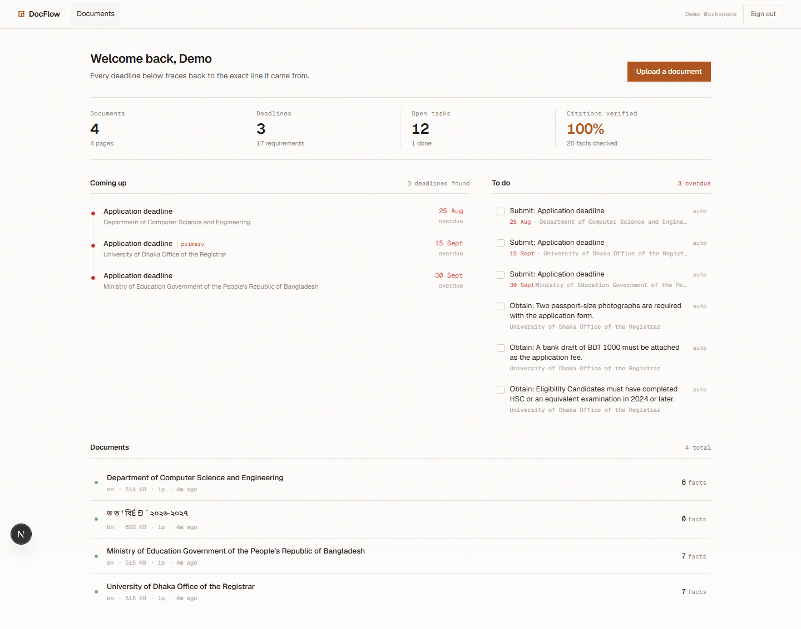
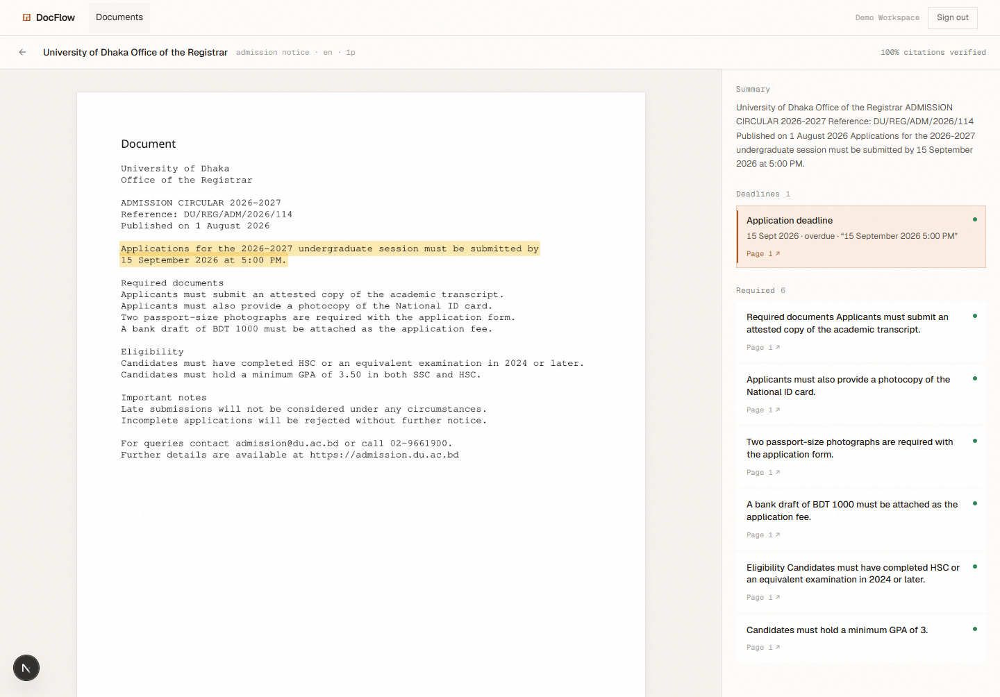
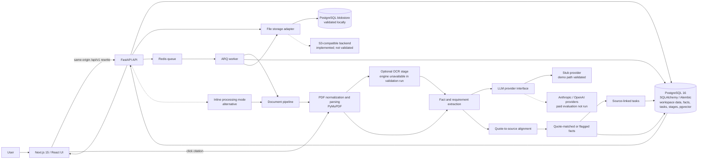

# DocFlow AI

A document-intelligence workspace that turns uploaded PDFs into reviewable facts, deadlines, requirements, and follow-up tasks. Facts include a source quote and page reference so a reviewer can inspect the underlying document.

> This repository is a fork of [A-K-M-Asifuzzaman/DocFlow-AI](https://github.com/A-K-M-Asifuzzaman/DocFlow-AI). The upstream project supplies the product implementation. This README distinguishes upstream capabilities from local changes in this checkout.

## Project overview

Document workflows often leave people to find a deadline, interpret a requirement, and remember the next action by reading a PDF manually. DocFlow provides a workspace for reviewing extracted information alongside its source page.

The screenshots below are from a locally running instance using the repository's seeded demo workspace. The demo uses the Stub Provider; it does not call a paid model or represent production usage.

### Workspace and task list



### Citation review



The seeded sample dates are fixed and appear overdue in these captures dated 2026-10-27. An earlier capture showed 16 September for a source deadline of 15 September. The date path was traced and corrected: the Stub Provider now preserves the explicit 5:00 PM, normalization receives the time, and the UI formats absolute deadline dates in the configured source normalization timezone (Asia/Dhaka). The updated citation view shows 15 September 2026, matching the source. General date interpretation still requires review when the source timezone is unknown or ambiguous.

## Problem statement

Summaries alone do not make a document actionable. A user still needs to verify each statement, identify a date, and track the work that follows. DocFlow connects candidate facts to page-level source evidence and presents related tasks in the same workspace.

Citation verification checks whether an extracted quote can be aligned with source text. It does not establish that a normalized value, such as a date, is semantically correct.

## Key features present in the codebase

- A Next.js and React workspace for documents, deadlines, tasks, and document review.
- A FastAPI API for authentication, document handling, analysis, dashboard data, and blob access.
- A PDF processing pipeline using PyMuPDF, with an optional OCR stage when an OCR engine is available.
- Fact extraction through a provider abstraction, with Anthropic, OpenAI, and a deterministic Stub Provider implementation in the codebase.
- Quote alignment and citation metadata that can be used to highlight source text in the viewer.
- Asynchronous document jobs using Redis and ARQ, plus an inline processing mode.
- PostgreSQL persistence with SQLAlchemy, Alembic migrations, tenant-scoped data, and pgvector-backed embeddings.
- AI-generated tasks linked to source facts, with task status stored in the database.
- A storage adapter with PostgreSQL blob storage and an S3-compatible implementation. Only the PostgreSQL blob store was validated in the recorded local run.

These are codebase capabilities; the limitations below describe which paths were actually verified.

## Architecture

The editable source is [docs/architecture.mmd](docs/architecture.mmd). The diagram reflects the current code paths and marks unvalidated alternatives separately.



## Technology stack

- Frontend: Next.js 15, React 19, TypeScript, Vitest, ESLint.
- API and worker: Python 3.12, FastAPI, SQLAlchemy 2, Alembic, ARQ.
- Data and queue: PostgreSQL 16, pgvector, Redis.
- Document and AI integrations: PyMuPDF, optional pytesseract, Anthropic and OpenAI adapters, Stub Provider.
- Local tooling: uv, npm, Docker Compose, pytest, Ruff, mypy, Playwright configuration.

## Document processing workflow

The API accepts a document and records its processing state. In queue mode it sends a job through Redis to the ARQ worker; inline mode is an alternative implemented in the queue service. The worker advances the document through normalization and parsing, optional OCR, extraction, citation alignment, and later indexing steps. Pipeline and document state are persisted in PostgreSQL.

The extraction layer returns candidate facts and requirements. Citation alignment attempts to match each quote to page text and geometry; the viewer uses that metadata to show the source. An unmatched or low-confidence citation must not be described as confirmed evidence.

The local validation run used the PostgreSQL blob store. S3-compatible storage exists in code but has not been validated in the documented environment. OCR was unavailable during validation, so scanned documents and Bangla OCR were not established as working paths.

## Task generation and status management

Extracted requirements can produce tasks linked to their source facts. Tasks are persisted and surfaced in the workspace with their status and due date. The seeded run recorded four sample documents and twelve generated tasks; the dashboard also included a completed demo task. The visible overdue state in the screenshot reflects fixed sample dates and the capture date, not a current operational deadline feed.

## Local setup

The repository defines the following developer workflow in the root Makefile:

```bash
cp .env.example .env
make setup
make seed
make dev
```

The Makefile's setup target installs Python and web dependencies, starts the Docker Compose services, and applies migrations. The seed target loads the demo workspace without LLM calls. The dev target runs the API, worker, and web application.

These targets were inspected in the source but were not rerun as a one-command workflow in this documentation pass. The recorded Windows validation used isolated PostgreSQL and Redis services with the PostgreSQL blob store. Direct Alembic config loading under the machine's cp936 locale required a temporary UTF-8/ASCII config outside the repository. For Windows reproduction, use a UTF-8 Git Bash or WSL environment and follow the repository's Makefile. The default Compose setup also includes MinIO; MinIO/S3 was not validated here.

Create a local environment file from the template and configure it for the services you run. For the validated demo path, use the Stub Provider with demo mode enabled and PostgreSQL blob storage. Do not put credentials in the repository. See [.env.example](.env.example) for configuration names; this README intentionally does not reproduce credential values.

## Running tests and checks

The repository's Makefile defines the test and check commands. For example:

```bash
make test-unit
make test-web
make lint
npm run check:mermaid
```

Current local verification on 2026-10-27: 347 non-eval backend tests passed; the 7 frontend unit tests passed; Ruff lint and format, mypy (88 files), TypeScript, ESLint, and the production build passed. ESLint and the production build each report the existing custom-font warning. The date regression is covered by backend extraction/API checks and two frontend timezone-formatting cases. Detailed commands, outcomes, environment, and unrun paths are recorded in [reports/validation/FINAL_LOCAL_QA.md](reports/validation/FINAL_LOCAL_QA.md).

The screenshot browser flow is not a Playwright E2E suite run. Playwright E2E and paid-provider evaluation were not run. The paid evaluation target is explicitly marked as costing money in the Makefile.

## Demo and screenshots

The earlier captures `01-workspace.png` and `02-citation-detail.png` are retained as historical evidence. The current screenshots `03-workspace-date-fixed.png` and `04-citation-date-fixed.png` were captured from the locally running application on 2026-10-27 after opening the seeded demo workspace. They show the workspace and a selected citation whose displayed date is 15 September 2026, matching the source quote. The demo path used the Stub Provider and did not use a paid model or a real account.

The screen shows 20 facts checked and a 100% citation verification indicator for this seeded dataset. This is a quote-alignment result for the demo, not a measure of semantic correctness, date accuracy, or production reliability.

## Engineering decisions visible in the implementation

- Processing state is persisted in PostgreSQL; Redis is used to deliver queued work.
- The worker can process asynchronously, while an inline mode is also available.
- Citation metadata connects extracted facts to page text and viewer highlights.
- AI tasks are constrained by a database check that requires an AI-originated task to reference a source fact.
- The provider layer allows the deterministic Stub Provider to exercise a no-paid-model path.
- PostgreSQL blob storage is a documented alternative to S3-compatible storage, but only the PostgreSQL path was validated in the reported run.

## Known limitations and unverified paths

- **Date interpretation:** the reproduced September 15 versus September 16 display mismatch was corrected and covered by regression checks. Other date formats, ambiguous source timezones, and multilingual expressions still need broader evaluation; citation quote matching does not establish semantic correctness.
- **OCR:** an OCR engine was unavailable in the validation environment. Scanned-image extraction and Bangla OCR are not verified; the seeded Bangla document had no extracted facts in that run.
- **MinIO/S3:** not validated. The local validation used PostgreSQL blob storage.
- **Playwright E2E:** not run as a test suite.
- **Paid model evaluation:** not run; no paid provider was used for screenshots or the stub demo.
- **Deployment and usage:** this portfolio material does not claim a live production deployment, customers, or production usage.
- **Fresh Windows setup:** the standard Makefile flow was not rerun end-to-end on Windows; Alembic config encoding required a temporary workaround in the recorded run.

## Upstream attribution and my contributions

### Project origin and upstream attribution

This repository is a fork of [A-K-M-Asifuzzaman/DocFlow-AI](https://github.com/A-K-M-Asifuzzaman/DocFlow-AI). The core product, document pipeline, UI, database design, provider adapters, task model, and existing project documentation originate in the upstream repository. They are not claimed as original work in this portfolio.

### My contributions

### Local changes confirmed in this checkout

The local contribution in this portfolio update, based on branch portfolio/initial-validation at the upstream baseline commit, consists of:

- Added a Vitest configuration and two focused frontend test files, with seven unit cases covering existing utility/type behavior and deadline timezone formatting.
- Added an ESLint flat configuration and wired the web lint script to ESLint CLI; the package manifests include the needed lint/test dependencies.
- Fixed Ruff formatting and mypy findings across the Python API, including explicit typing and a rename from the conflicting PipelineStage index property to position.
- Made a source-inspection security test read source as UTF-8 explicitly for Windows.
- Corrected the README seed comment from three to four sample documents, matching the seed source and successful seed run.
- Added this portfolio README, the editable architecture diagram, and real local screenshots. The newer date-fix captures are separate files; the earlier screenshots remain intact as historical evidence.
- Fixed the traced deadline path: the Stub Provider now extracts an explicit time, the extraction layer passes it into normalization, and deadline calendar labels use Asia/Dhaka by default while preserving raw date/time evidence in the citation card.

The code changes above are supported by the dated validation report. They are limited engineering and documentation changes; they do not make the upstream product my original project. The README rewrite and diagram are part of this portfolio documentation update, not upstream product features.

### Validation evidence

The current check matrix, exact commands, screenshots, database migration, and known unrun paths are recorded in [reports/validation/FINAL_LOCAL_QA.md](reports/validation/FINAL_LOCAL_QA.md). The date root-cause analysis is in [reports/validation/DATE_DISCREPANCY_INVESTIGATION.md](reports/validation/DATE_DISCREPANCY_INVESTIGATION.md). Results describe local tests and a Stub Provider demo, not production usage.

### Known limitations

OCR/scanned documents, MinIO/S3, the Playwright E2E suite, paid model evaluation, unknown source timezones, and a clean one-command Windows setup remain unverified. See the limitations section above and the QA report.

### Upstream features versus local contribution

The core application capabilities described in the feature list pre-existed in the fork. The local contribution evidenced here is primarily test/lint/type-check setup, narrow correctness/compatibility fixes, and portfolio documentation. The validation report records the commands and outcomes for those changes.

## License

The repository retains the upstream MIT License and its existing copyright notice in [LICENSE](LICENSE). This README does not change or replace that license.
