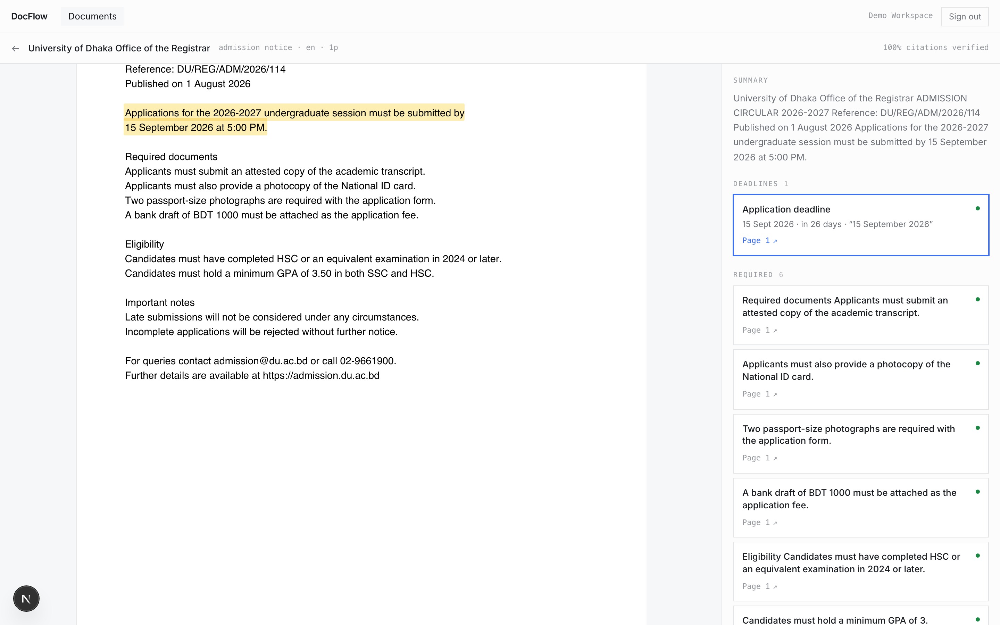
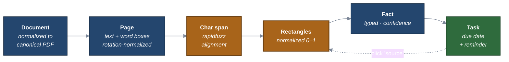

# DocFlow AI

> **Turn documents into decisions, deadlines, tasks and actions** — with every fact traceable to the exact line it came from.

[](https://github.com/A-K-M-Asifuzzaman/DocFlow-AI/actions/workflows/ci.yml)
[](apps/api/tests)
[](apps/api/pyproject.toml)
[](LICENSE)



*Click the deadline on the right; the source sentence highlights on the left. The card shows the
normalized date, how long is left, **and** the raw text the document actually contained.*

---

## The problem with document AI

Most document AI stops at *summarize* and *chat*. The user still has to read the
answer, work out what it means, and remember to act on it.

DocFlow extracts **typed, verified obligations** — deadlines with real dates,
requirements with checkboxes, tasks with due dates — and refuses to show you a
fact it cannot point to in the source.

```
Most document AI:   Document → Summary → Chat
DocFlow:            Document → Understand → Extract → Decide → Act → Track
```

## The one thing that must be right

> **The Provenance Chain**
> `document → page → character span → bounding box → fact → task`
>
> Every extracted fact carries a verified quote. If the quote cannot be matched
> against the source text, the fact is **not** shown as confirmed.

This is simultaneously the product, the trust model, the primary evaluation
metric, and the anti-hallucination defense — a fabricated fact cannot produce a
quote that fuzzy-matches real page text at ≥ 95, so **citation verification rate
doubles as a hallucination metric that needs no judge model and no labels**.

## Live

| | |
|---|---|
| App | https://docflow-ai-six.vercel.app |
| API | https://docflow-api-r6wg.onrender.com/health |

Free tier: the API spins down after ~15 minutes idle, so the first request can
take 30–50s. Deployment details and the trade-offs behind it:
[docs/DEPLOYMENT.md](docs/DEPLOYMENT.md).

## Run it locally

```bash
git clone https://github.com/A-K-M-Asifuzzaman/DocFlow-AI.git
cd DocFlow-AI
make setup      # docker compose + migrations
make seed       # 3 processed documents + 12 generated tasks
make dev        # api + worker + web
```

**No API keys required.** With no provider key configured, a deterministic stub
provider runs the whole pipeline offline — quotes lifted verbatim from the input,
so span alignment, confidence scoring and citation verification all genuinely
execute rather than being mocked out.

Demo sign-in: `demo@docflow.ai` / `demo-workspace-2026`

## Architecture

**[📐 All 12 diagrams →](docs/ARCHITECTURE.md)** — system, pipeline, OCR tiers,
RAG routing, span alignment, injection defense, tenancy, deployment, CI, ER.



## Measured results

Real numbers from real runs. Full methodology and caveats:
**[docs/EVALUATION.md](docs/EVALUATION.md)**

| What | Result | How |
|---|---|---|
| Highlight lands on the ink, at 0/90/180/270° page rotation | **> 85%** of page ink inside the computed rect | Rendered to a bitmap and measured, not asserted numerically |
| Citation verification rate, clean digital PDF, end to end | **1.0** | Full pipeline, real Postgres + MinIO |
| Tenant isolation | **48/48** | Parameterised over every table carrying `WorkspaceScopedMixin` |
| Authorization matrix | **99/99** | Every role × permission pair vs. a hand-written expected table |
| Cross-lingual similarity, identical deadline EN↔BN | **0.297** (control 0.018) | Live `text-embedding-3-small` — **a measured weakness**, see below |
| Modelled cost, 10-page document | **≈ $0.065** | Asserted in CI against published pricing |

**Two design-document assumptions were measured and found wrong**, and are
corrected in the docs:

- The native-text-layer gate was specified as *"≥40% word-box coverage"*. A
  **dense full A4 page measures 0.309** — a 40% gate would have sent every real
  page to OCR. Wrong by ~50×.
- `text-embedding-3-small` scores **0.297** on an identical deadline sentence in
  English vs. Bangla. Above the 0.018 noise floor but weak for identical
  meaning — direct evidence for the planned `bge-m3` benchmark, which the
  blueprint had listed only as a hypothesis.

## Engineering decisions

Each has a documented alternative and a stated condition under which it would be
wrong. Full reasoning in [`docs/`](docs/).

| Decision | Why |
|---|---|
| **Normalize every input to PDF + page image + word map** | One viewer, one citation model, for every format |
| **Citations are computed, not trusted** | Fuzzy span alignment → word boxes → rects; unmatched quotes are flagged, never faked |
| **Full-document context first, RAG second** | A 10-page circular fits in context. RAG is for corpus scale, not document scale |
| **Dates normalized by code, not the model** | `05/09/2026` is flagged *ambiguous* with both readings offered, never guessed |
| **Confidence computed and calibrated** | Self-reported model confidence is poorly calibrated; an unverified citation is hard-capped |
| **One `document_facts` table, not five** | Shared provenance; a new document vertical needs **no migration** |
| **Postgres RLS beneath app-level filtering** | A forgotten `WHERE` returns zero rows instead of another tenant's data |
| **Pipeline state in Postgres, queue is only delivery** | A crashed worker resumes at the failed stage — verified by a test |
| **No LangChain** | ~300 lines of adapters keeps token accounting, cache breakpoints and cost attribution under our control |
| **Document content is untrusted with zero capability** | The extraction call has no tools, no network, no database |

### On prompt injection, honestly

> DocFlow does not claim immunity to prompt injection. It is architected so
> injection **cannot escalate**: the model has no tools, no network access and no
> database access. The blast radius is incorrect extracted data in one workspace,
> surfaced with a warning banner.

The test suite includes a case asserting that a novel paraphrase is **not**
caught by the heuristic — a security suite that only asserts successes is
marketing.

## Documentation

| Doc | Contains |
|---|---|
| [ARCHITECTURE.md](docs/ARCHITECTURE.md) | All 12 diagrams |
| [EVALUATION.md](docs/EVALUATION.md) | Measured results, methodology, open gaps |
| [00-product.md](docs/00-product.md) | Vision, users, journeys, MVP scope, roadmap |
| [10-architecture.md](docs/10-architecture.md) | System, pipeline, jobs, tenancy, deployment |
| [20-ai.md](docs/20-ai.md) | Extraction, RAG, evaluation framework, cost model |
| [30-data-api.md](docs/30-data-api.md) | Schema, ER diagram, API contract |
| [40-frontend.md](docs/40-frontend.md) | Frontend architecture, viewer deep-dive |
| [50-security-ops.md](docs/50-security-ops.md) | 20-threat model, observability, testing, CI/CD |
| [60-delivery.md](docs/60-delivery.md) | Repo structure, phases, hackathon strategy, risks |
| [prompt.md](prompt.md) | Frontend implementation brief |

## Stack

**Backend** Python 3.12 · FastAPI · SQLAlchemy 2 (async) · Alembic · ARQ · Pydantic v2
**Data** PostgreSQL 16 · pgvector (HNSW) · RLS · Redis · S3/R2 (MinIO locally)
**AI** Anthropic / OpenAI behind a tier-based abstraction · PyMuPDF · Tesseract · rapidfuzz · dateparser
**Tooling** uv · ruff · mypy · pytest · Docker · GitHub Actions

## Status

Backend is **working end to end**: upload → validate → normalize → parse → OCR →
extract → align → chunk → embed → index, with facts, citations, rectangles and
normalized due dates returned over HTTP.

| Area | State |
|---|---|
| Schema, migrations, RLS | ✅ 3 migrations, round-trip verified, no drift |
| Document pipeline (11 stages) | ✅ resumable, idempotent, integration-tested |
| Span alignment & citations | ✅ verified against rendered pixels |
| LLM abstraction + usage ledger | ✅ 3 providers, cost per call recorded |
| Auth, permissions, API | ✅ 331 backend tests |
| Frontend + viewer | ✅ 5/5 Playwright E2E in Chromium |
| Grounded chat / hybrid retrieval | 🚧 chunks + embeddings land; query path next |
| Labeled eval dataset | ⬜ the blocking gap — see [EVALUATION.md](docs/EVALUATION.md) §6 |

**Before scaling the wedge:** run the Bangla OCR spike — 20 real scanned
circulars through Tesseract `ben`, accuracy measured by hand. The entire
Bangladesh-first thesis rests on that assumption and it is still unvalidated.

## License

MIT
