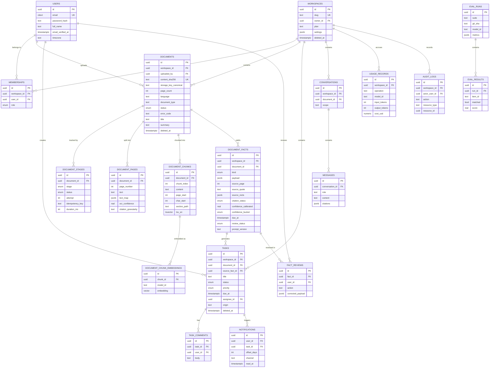

# DocFlow AI — Part 3: Database & API

> Sections 12 (database schema) and 13 (API architecture). Includes Appendix C (ER diagram) and Appendix D (endpoint map).

---

## 12. Database Schema

### 12.1 Challenging your proposed table list

You proposed 19 tables. Here is what I would change and why.

| Your proposal | Verdict | Reasoning |
|---|---|---|
| `organizations` **and** `workspaces` | **Merge → `workspaces`** | Two tenancy levels on day one costs a join, a second permission surface, and a concept users can't explain. Add `organizations` above workspaces when billing arrives — an additive migration. |
| `document_entities`, `document_deadlines`, `document_requirements`, `document_action_items` | **Merge → `document_facts`** | They share ~80% of their columns: provenance, quote, page, rects, confidence, review state, extraction method, prompt version. Four tables means four citation implementations, four review UIs, four audit paths, and four places to forget `workspace_id`. See §12.3. |
| `subscriptions` | **Cut from MVP** | No paying users. Enforce quotas against `usage_daily` instead — 3 lines of code. |
| `conversations`, `messages` | **Keep, minimal** | Needed for chat history. Two tables, no branching, no threads. |
| `notifications` | **Keep** | Needs a `UNIQUE (task_id, offset_days)` to make reminders exactly-once. |
| `usage_records` | **Keep, and build it week 1** | Powers cost dashboards, budgets, eval reports, and future billing from one append-only table. |
| `audit_logs` | **Keep, append-only** | Add a monthly partition in Phase 3, not before. |
| — | **Add `document_stages`** | The pipeline state machine (§11.3). This is what makes processing resumable and idempotent. |
| — | **Add `document_chunk_embeddings`** | Separate from `document_chunks` so two embedding models can coexist during migration. |
| — | **Add `fact_reviews`** | User ✓/✎/✗ feedback. Free eval labels; the evaluation flywheel depends on it. |
| — | **Add `idempotency_keys`** | Safe POST retries. |
| — | **Add `embedding_cache`** | Global content-hash → vector. Direct cost savings. |
| — | **Add `eval_runs`, `eval_results`** | Evaluation is a first-class subsystem, not a script. |

**Net: 21 tables, of which ~15 are needed for MVP.**

### 12.2 Conventions

- **`uuid` v7 primary keys** (`id UUID PRIMARY KEY DEFAULT uuidv7()`). Time-ordered like a bigint (good index locality, no page splits) but non-enumerable and safe to expose. Sequential integers in URLs invite IDOR probing and leak business volume.
- **`workspace_id UUID NOT NULL`** on every tenant table, even where derivable via a join. Denormalized deliberately: RLS policies must be single-table predicates, and it keeps every index tenant-prefixed.
- **`created_at`, `updated_at`** `timestamptz NOT NULL DEFAULT now()`; `updated_at` maintained by trigger, never by the app.
- **All timestamps `timestamptz`, stored UTC.** Never `timestamp`. Workspace timezone is a display and scheduling concern.
- **Enums as Postgres native `ENUM`** for stable small sets (`role`, `document_status`, `fact_kind`); `TEXT` + `CHECK` where values will churn.
- **Money as `NUMERIC(12,6)`** for `cost_usd` — sub-cent precision matters when a call costs $0.000015.
- **Soft delete (`deleted_at`) on only three tables**: `documents`, `tasks`, `workspaces`. Everywhere else it is dead weight and a permanent source of "forgot the `deleted_at IS NULL`" bugs. Children are hard-deleted by cascade when a soft-deleted parent is purged after 30 days.

### 12.3 The `document_facts` decision — the schema's central call

**One table with a `kind` discriminator plus a typed `payload JSONB`, not five tables.**

```sql
CREATE TABLE document_facts (
  id                    UUID PRIMARY KEY DEFAULT uuidv7(),
  workspace_id          UUID NOT NULL REFERENCES workspaces(id) ON DELETE CASCADE,
  document_id           UUID NOT NULL REFERENCES documents(id) ON DELETE CASCADE,
  kind                  fact_kind NOT NULL,
  payload               JSONB    NOT NULL,

  -- provenance (identical for every kind — this is why they share a table)
  source_page           INT      NOT NULL,
  source_quote          TEXT     NOT NULL,
  source_char_start     INT,
  source_char_end       INT,
  source_rects          JSONB,           -- [{page,x0,y0,x1,y1}] normalized 0..1
  citation_status       citation_status NOT NULL DEFAULT 'unverified',
  citation_match_score  REAL,

  -- scoring
  confidence_raw        REAL     NOT NULL,
  confidence_calibrated REAL     NOT NULL,
  confidence_bucket     confidence_bucket NOT NULL,

  -- lineage
  extraction_method     TEXT     NOT NULL,  -- llm_extraction | rule | user
  model_id              TEXT,
  prompt_version        TEXT,
  extracted_at          TIMESTAMPTZ NOT NULL DEFAULT now(),

  -- review state
  review_status         review_status NOT NULL DEFAULT 'pending',
  reviewed_by           UUID REFERENCES users(id) ON DELETE SET NULL,
  reviewed_at           TIMESTAMPTZ,

  -- promoted from payload for indexing (see below)
  due_at                TIMESTAMPTZ,
  normalization_status  TEXT,
  is_primary            BOOLEAN  NOT NULL DEFAULT false,

  created_at TIMESTAMPTZ NOT NULL DEFAULT now(),
  updated_at TIMESTAMPTZ NOT NULL DEFAULT now(),

  CONSTRAINT payload_shape CHECK (jsonb_typeof(payload) = 'object'),
  CONSTRAINT deadline_needs_raw_text CHECK (
    kind <> 'deadline' OR payload ? 'raw_date_text'
  )
);
```

**Why one table:**
- One provenance model → one span-alignment implementation → one highlight code path.
- One review UI and one `fact_reviews` foreign key.
- `GET /documents/{id}/analysis` is one query, not five.
- Adding a fact kind (`decision`, `penalty`, `obligation`, and every future vertical) is a new enum value plus a Pydantic model — **no migration**. This is precisely what makes the hackathon pivot and new verticals cheap.

**Why hot fields are promoted to real columns rather than left in JSONB:** `due_at` drives the calendar, reminder cron, and dashboard. A B-tree index on a real column beats a JSONB expression index for range scans and keeps the planner honest. **Promote a field the moment it appears in a `WHERE` or `ORDER BY`; leave the rest in JSONB.** That is the rule.

**The honest cost:** JSONB gives up column-level type enforcement and foreign keys inside the payload. Mitigations: Pydantic discriminated-union validation on every write (the only write path is the service layer), `CHECK` constraints for kind-specific invariants, and a schema-version field inside the payload.

**When to break a kind out into its own table:** when it grows independent lifecycle, its own children, or its own permissions. **`tasks` is exactly that case** — it has status transitions, assignment, comments, and reminders, so it is a real table that *references* `source_fact_id`. Facts are immutable observations about a document; tasks are mutable objects with a life of their own. That is the line.

### 12.4 Core tables

```sql
users(id, email UK CITEXT, password_hash, full_name, avatar_url,
      email_verified_at, timezone DEFAULT 'Asia/Dhaka', locale DEFAULT 'en',
      last_login_at, created_at, updated_at)

workspaces(id, name, slug UK, owner_id FK→users, timezone,
           plan TEXT DEFAULT 'free', settings JSONB DEFAULT '{}',
           deleted_at, created_at, updated_at)

memberships(id, workspace_id FK, user_id FK, role workspace_role,
            invited_by FK→users, joined_at, created_at)
  UNIQUE (workspace_id, user_id)

documents(id, workspace_id FK, uploaded_by FK→users,
          original_filename, mime_type, size_bytes, content_sha256,
          storage_key_original, storage_key_canonical,
          page_count, language, document_type,
          status document_status, error_code, error_detail,
          title, summary, organization, reference_number, published_date,
          security_flags TEXT[] DEFAULT '{}',
          processing_started_at, processing_completed_at,
          deleted_at, created_at, updated_at)
  UNIQUE (workspace_id, content_sha256) WHERE deleted_at IS NULL    -- dedup

document_stages(id, document_id FK, stage document_stage, status stage_status,
                attempt INT DEFAULT 0, idempotency_key TEXT,
                started_at, finished_at, duration_ms,
                error_code, error_detail, output_ref JSONB)
  UNIQUE (document_id, stage)

document_pages(id, workspace_id FK, document_id FK, page_number INT,
               text TEXT, text_map JSONB,        -- word boxes; see §11.5
               width REAL, height REAL, rotation INT,
               storage_key_image, extraction_method, ocr_confidence REAL,
               citation_granularity TEXT DEFAULT 'span',   -- span | page
               created_at)
  UNIQUE (document_id, page_number)

document_chunks(id, workspace_id FK, document_id FK, chunk_index INT,
                content TEXT, content_sha256,
                token_count INT, page_start INT, page_end INT,
                char_start INT, char_end INT, section_path TEXT,
                tsv_en tsvector GENERATED, tsv_simple tsvector GENERATED,
                created_at)
  UNIQUE (document_id, chunk_index)

document_chunk_embeddings(id, chunk_id FK, model_id TEXT,
                          embedding vector(1536), created_at)
  UNIQUE (chunk_id, model_id)

document_facts(...)          -- §12.3

fact_reviews(id, workspace_id FK, fact_id FK, user_id FK,
             action TEXT,     -- confirm | edit | reject
             original_payload JSONB, corrected_payload JSONB,
             note TEXT, created_at)

tasks(id, workspace_id FK, document_id FK NULL, source_fact_id FK NULL,
      title, description, status task_status DEFAULT 'todo',
      priority task_priority DEFAULT 'medium',
      due_at, completed_at, assignee_id FK→users NULL,
      created_by FK→users, origin TEXT,     -- ai | user
      sort_order INT, deleted_at, created_at, updated_at)
  CHECK (origin <> 'ai' OR source_fact_id IS NOT NULL)   -- no ungrounded AI tasks

task_comments(id, workspace_id FK, task_id FK, user_id FK, body, created_at)

notifications(id, workspace_id FK, user_id FK, type notification_type,
              task_id FK NULL, document_id FK NULL,
              offset_days INT NULL, title, body, payload JSONB,
              channel TEXT,           -- in_app | email
              read_at, sent_at, created_at)
  UNIQUE (task_id, user_id, offset_days) WHERE task_id IS NOT NULL  -- exactly-once

conversations(id, workspace_id FK, user_id FK, document_id FK NULL,
              title, scope TEXT, created_at, updated_at)

messages(id, workspace_id FK, conversation_id FK, role TEXT,
         content TEXT, citations JSONB, model_id, token_usage JSONB,
         latency_ms, created_at)

usage_records(id, workspace_id FK, user_id FK NULL, document_id FK NULL,
              operation TEXT, provider TEXT, model_id TEXT, prompt_version TEXT,
              input_tokens, output_tokens, cache_read_tokens, cache_write_tokens,
              cost_usd NUMERIC(12,6), latency_ms, success BOOL,
              error_code, request_id, created_at)          -- APPEND ONLY

usage_daily(workspace_id, day DATE, operation, documents_processed,
            pages_processed, input_tokens, output_tokens, cost_usd)
  PRIMARY KEY (workspace_id, day, operation)               -- rollup for fast quota checks

audit_logs(id, workspace_id FK, actor_user_id FK NULL, actor_ip INET,
           action TEXT, resource_type TEXT, resource_id UUID,
           metadata JSONB, request_id, created_at)         -- APPEND ONLY

idempotency_keys(key TEXT, workspace_id FK, endpoint TEXT,
                 request_hash TEXT, response_status INT, response_body JSONB,
                 created_at, expires_at)
  PRIMARY KEY (key, workspace_id)

embedding_cache(content_sha256 TEXT, model_id TEXT,
                embedding vector(1536), hit_count INT, created_at)
  PRIMARY KEY (content_sha256, model_id)                   -- global, cross-tenant, no PII risk

eval_runs(id, suite, git_sha, model_id, prompt_version, dataset_version,
          metrics JSONB, item_count, total_cost_usd, duration_ms, created_at)
eval_results(id, run_id FK, item_id, predicted JSONB, expected JSONB,
             matched BOOL, score REAL, error TEXT)
```

### 12.5 Indexes

```sql
-- Tenant-prefixed: every list query starts with workspace_id
CREATE INDEX ON documents (workspace_id, created_at DESC)
  WHERE deleted_at IS NULL;
CREATE INDEX ON documents (workspace_id, status)
  WHERE status NOT IN ('completed','failed');       -- tiny; powers the processing poller
CREATE UNIQUE INDEX ON documents (workspace_id, content_sha256)
  WHERE deleted_at IS NULL;                          -- dedup

CREATE INDEX ON document_facts (document_id, kind);
CREATE INDEX ON document_facts (workspace_id, due_at)
  WHERE kind = 'deadline' AND due_at IS NOT NULL;    -- partial: calendar + reminders
CREATE INDEX ON document_facts (workspace_id, review_status)
  WHERE review_status = 'pending';

CREATE INDEX ON tasks (workspace_id, status, due_at)
  WHERE deleted_at IS NULL;
CREATE INDEX ON tasks (assignee_id, status) WHERE deleted_at IS NULL;

-- Lexical retrieval
CREATE INDEX ON document_chunks USING GIN (tsv_en);
CREATE INDEX ON document_chunks USING GIN (tsv_simple);
CREATE INDEX ON document_chunks USING GIN (content gin_trgm_ops);   -- Bangla fuzzy

-- Vector retrieval
CREATE INDEX ON document_chunk_embeddings
  USING hnsw (embedding vector_cosine_ops) WITH (m = 16, ef_construction = 64);

CREATE INDEX ON usage_records (workspace_id, created_at DESC);
CREATE INDEX ON audit_logs (workspace_id, created_at DESC);
CREATE INDEX ON audit_logs (resource_type, resource_id);
```

**pgvector notes that will matter:**
- `vector` HNSW indexes cap at **2000 dimensions**. 1536 is fine; 3072-dim models require `halfvec` (pgvector ≥ 0.7).
- Filtered vector search is the classic pgvector trap: filtering by `workspace_id` after an HNSW scan can return fewer than `k` rows. **pgvector ≥ 0.8's iterative index scans fix this** — set `hnsw.iterative_scan = 'relaxed_order'`. Pin pgvector ≥ 0.8 and add a recall test to the eval suite.
- HNSW index builds are memory-hungry. Set `maintenance_work_mem` high during migrations, and build the index **after** bulk-loading in any backfill.
- Do **not** create per-workspace partial vector indexes. It seems clever; it produces thousands of indexes and destroys planning time.

### 12.6 Cascades, integrity, retention

| Relationship | On delete | Why |
|---|---|---|
| `workspace → *` | `CASCADE` | Workspace deletion must be total |
| `document → pages/chunks/facts/stages` | `CASCADE` | Derived artifacts have no independent meaning |
| `fact → tasks.source_fact_id` | `SET NULL` | A task the user is working on must survive re-extraction |
| `user → documents.uploaded_by` | `SET NULL` | Documents outlive departing members |
| `user → memberships` | `CASCADE` | |
| `task → task_comments` | `CASCADE` | |
| `* → audit_logs` | **no FK** | Audit records must survive the deletion of what they describe |

**Retention:** soft delete sets `deleted_at`; the row and its blobs remain for 30 days (undo, accidental deletion). `retention_purge` then hard-deletes rows and storage objects. A GDPR/account-deletion request bypasses the 30 days and runs immediately, writing an audit record of the deletion itself.

**Audit strategy:** written at the service layer, not by database triggers. Triggers cannot see the request ID, the actor's IP, or the business intent, and they silently double-write during migrations. Audit at the point where intent is known: `document.view`, `document.download`, `document.delete`, `fact.edit`, `member.invite`, `role.change`, `export.create`, `auth.login`, `auth.failed`.

### 12.7 Migrations

Alembic, with these rules:
- One migration per PR; `alembic check` in CI fails on model/migration drift.
- **Expand → migrate → contract**, never destructive in a single deploy. Add a nullable column, backfill in a job, add the constraint, drop the old column in a later release.
- `CREATE INDEX CONCURRENTLY` for any table over ~100k rows (requires `autocommit_block()` in the migration).
- Every migration gets a tested `downgrade()`. CI runs `upgrade head` → `downgrade -1` → `upgrade head` on a fresh DB.
- RLS policies live in migrations, and the tenant-isolation test suite (§17.3) is the guard that they were not forgotten.

---

## Appendix C — Database ER Diagram



---

## 13. API Architecture

### 13.1 Cross-cutting contracts

**Versioning.** `/api/v1/...` in the path. Header-based negotiation is more elegant and worse in practice — you cannot paste it into a browser, curl it, or cache it by URL. v2 ships alongside v1 with a 6-month deprecation window announced via a `Sunset` header.

**Auth.** `Authorization: Bearer <access_jwt>` (15 min, held in JS memory, never localStorage). Refresh token in an httpOnly + Secure + SameSite=Lax cookie scoped to `/api/v1/auth/refresh` only, rotated on every use with reuse detection (a replayed refresh token revokes the whole family — this is how you detect token theft).

*Why access-token-in-memory:* immune to CSRF (no ambient credential on API calls) and to XSS-reads-localStorage. Cost: a token refresh on page load. Worth it.

**Tenant context.** `X-Workspace-Id` header, or the user's default workspace. Middleware verifies membership, then `SET LOCAL app.workspace_id`. **Workspace never comes from a request body or a path param used for filtering.**

**Errors — RFC 9457 Problem Details:**
```json
{
  "type": "https://docflow.ai/errors/document-too-large",
  "title": "Document exceeds size limit",
  "status": 413,
  "detail": "File is 47.2 MB; the limit is 25 MB.",
  "instance": "/api/v1/documents",
  "code": "DOCUMENT_TOO_LARGE",
  "request_id": "01JD8...",
  "errors": [{"field": "file", "message": "..."}]
}
```
`code` is the stable machine-readable contract; `title`/`detail` are human strings that may change. Never leak stack traces, SQL, or internal paths.

**Pagination — cursor/keyset only.**
```
GET /v1/documents?limit=25&cursor=eyJjIjoiMjAyNi0wOC0yMFQxMDowMDowMFoiLCJpIjoiMDFKRDgifQ
→ { "data": [...], "next_cursor": "...", "has_more": true }
```
Cursor is base64 of `(created_at, id)`. Offset pagination skips and duplicates rows under concurrent inserts and degrades linearly with depth. There is no case in this product where offset is correct.

**Idempotency.** `Idempotency-Key` header required on `POST /documents` and `POST /chat/messages`, optional elsewhere. Stored with a hash of the request body: same key + same body replays the stored response; same key + different body → `409 IDEMPOTENCY_KEY_REUSE`. 24 h TTL.

**Rate limits.** Redis token bucket, per user **and** per workspace, by endpoint class. Always return `RateLimit-Limit`, `RateLimit-Remaining`, `RateLimit-Reset`, and `Retry-After` on 429.

| Class | Per user | Per workspace | Rationale |
|---|---|---|---|
| Auth (login, register, reset) | 5/min | — | Credential stuffing |
| Upload | 20/hour | 200/hour | Cost + storage |
| Chat / search | 30/min | 300/min | LLM cost |
| Read | 300/min | 3000/min | Generous |
| Export | 5/hour | 20/hour | Expensive |

### 13.2 Endpoint specifications (the ones with real decisions)

---

**`POST /api/v1/documents`** — upload

| | |
|---|---|
| Auth | Bearer, required |
| Authz | `member`+ in the target workspace |
| Request | `multipart/form-data`: `file` (required), `title?`, `document_type_hint?` |
| Headers | `Idempotency-Key` (required), `X-Workspace-Id` |
| Success | `202 Accepted` → `{id, status:"queued", original_filename, size_bytes, created_at, poll_url, duplicate_of?}` |
| Errors | `400 INVALID_FILE_TYPE` · `409 DUPLICATE_DOCUMENT` (with the existing id) · `413 DOCUMENT_TOO_LARGE` · `422 CORRUPT_DOCUMENT` · `429` · `402 QUOTA_EXCEEDED` |
| Limits | 25 MB, 150 pages, MIME whitelist enforced by **magic bytes**, not by the declared `Content-Type` |

*Design note — why multipart and not presigned direct upload for MVP:* presigned upload needs `POST /upload-intent` → client PUT → `POST /{id}/complete`, plus reconciliation for abandoned uploads and a quarantine promotion flow. That is real complexity for zero MVP benefit at a 25 MB cap. **Switch to presigned when the limit exceeds ~50 MB or upload timeouts appear in metrics** — the API shape is designed so that switch is additive.

*Dedup:* server computes SHA-256 during streaming. On a match within the workspace, return `409` with `duplicate_of` and do not re-process. Cost of a duplicate upload: $0.

---

**`GET /api/v1/documents`** — list

Query params: `cursor`, `limit` (≤100), `status`, `document_type`, `language`, `q` (title/summary search), `has_upcoming_deadline`, `sort` ∈ `created_at|-created_at|title|-title|due_at`.
Sort fields are a **whitelist mapped to column objects** — never string-interpolated into SQL. Returns lightweight summaries (no facts, no pages) with a `deadline_summary` aggregate so the list renders without N+1.

---

**`GET /api/v1/documents/{id}`** and **`/analysis`**

`{id}` returns the document plus its `stages[]` (so the processing UI is one request). `/analysis` returns the aggregate the detail page needs in one round trip: document metadata, `facts[]` grouped by kind, `page_count`, `security_flags`, `confidence_summary`. `?include_low_confidence=true` adds the collapsed tier. `?kinds=deadline,requirement` filters.

Both are `Cache-Control: private, max-age=0, must-revalidate` with an `ETag` — the analysis of a completed document is immutable until re-extraction, so ETags are genuinely effective here.

---

**`GET /api/v1/documents/{id}/events`** — SSE processing stream *(Phase 2; MVP polls `{id}` with backoff)*

```
event: stage
data: {"stage":"extracting","status":"running","progress":0.4,"message":"Analyzing pages 5–8"}

event: completed
data: {"document_id":"...","fact_count":14}
```

*Why SSE over WebSockets:* one-directional, plain HTTP (no proxy/CDN upgrade problems), automatic browser reconnect with `Last-Event-ID`, and trivial to implement in FastAPI. WebSockets buy bidirectionality that this product does not need. **Use WS only when** you add collaborative editing or presence.

---

**`POST /api/v1/documents/{id}/tasks:generate`**

Non-CRUD action, so it gets a `:verb` suffix rather than being contorted into a resource. Body: `{fact_ids?: uuid[], include_low_confidence?: bool}`. Returns `201` with created tasks. Idempotent via `Idempotency-Key`; without one, re-running de-duplicates against existing tasks with the same `source_fact_id`.

---

**`POST /api/v1/chat/messages`** — streaming grounded Q&A

Body: `{conversation_id?, document_id?, scope: "document"|"workspace", message, stream: true}`
Response: `text/event-stream` with typed events —

```
event: meta      data: {"conversation_id":"...","strategy":"full_context","model":"claude-sonnet-5"}
event: token     data: {"text":"The deadline is "}
event: citation  data: {"marker":"S1","document_id":"...","page":3,
                        "rects":[{"x0":0.12,"y0":0.44,"x1":0.87,"y1":0.47}],
                        "quote":"Applications must be submitted by 15 September 2026"}
event: usage     data: {"input_tokens":6120,"output_tokens":210,"cost_usd":0.0215}
event: done      data: {"message_id":"...","citation_count":2}
event: error     data: {"code":"BUDGET_EXCEEDED","detail":"..."}
```

**Citations stream as structured events, not as text markers to be parsed client-side.** Parsing `[S1]` out of a token stream is fragile (markers split across token boundaries) and couples the UI to a text format. Typed events let the UI render source pills the instant they resolve.

`strategy` in the `meta` event exposes whether full-context or retrieval was used — useful for debugging and quietly demonstrates the routing decision from §10.1.

---

**`GET /api/v1/search`**

`q` (required), `scope`, `document_id?`, `kinds?`, `k` (≤50), `mode` ∈ `hybrid|lexical|semantic` (default `hybrid`).
Returns chunks with `score`, `retriever_scores` (per-retriever ranks), page, section path, and highlight rects. Exposing `retriever_scores` costs nothing and makes the hybrid pipeline legible in the UI and in demos.

---

**`GET /api/v1/deadlines`** and the `/calendar` endpoint I am cutting

`GET /v1/deadlines?from=&to=&status=&document_id=&group_by=day|week|month`

**I recommend dropping `GET /v1/calendar`.** A calendar is a *rendering* of deadlines, not a distinct resource. Two endpoints returning the same rows in different shapes doubles the surface, the tests, and the caching story. `group_by` covers the calendar's needs.

**Add instead: `GET /api/v1/deadlines.ics`** — an authenticated iCalendar feed (token in the URL, since calendar clients cannot send headers; the token is per-user, revocable, read-only, scoped to this feed alone). Users subscribe once in Google/Apple Calendar and DocFlow deadlines appear where they already look. Very high value per line of code.

---

**Tasks.** `GET /v1/tasks` (filters: status, assignee, due range, document, overdue), `POST /v1/tasks`, `PATCH /v1/tasks/{id}` (partial; `If-Match` ETag for optimistic concurrency on shared workspaces), `DELETE` (soft), `POST /v1/tasks/{id}/comments`.

**Facts.** `GET /v1/documents/{id}/facts` (filtered access), `PATCH /v1/facts/{id}` (user correction — writes `fact_reviews` and flips `review_status`), `POST /v1/facts/{id}/review` (`{action: confirm|reject, note?}`).

**Auth.** `POST /v1/auth/register|login|refresh|logout|verify-email|forgot-password|reset-password`, `GET /v1/auth/me`, `GET|POST /v1/auth/oauth/google`.

**Workspaces.** `GET|POST /v1/workspaces`, `PATCH /v1/workspaces/{id}`, `GET|POST /v1/workspaces/{id}/members`, `PATCH|DELETE /v1/workspaces/{id}/members/{user_id}`, `POST /v1/workspaces/{id}/invites`.

**Usage.** `GET /v1/usage?from=&to=&group_by=day|operation` → tokens, cost, documents, pages, and quota headroom.

### 13.3 OpenAPI → typed TypeScript client

FastAPI emits OpenAPI 3.1 → `openapi-typescript` generates types → `openapi-fetch` provides a ~6 kB typed client in `packages/api-client`. CI regenerates and fails if the committed schema drifts from the code.

*Why not orval/heavy codegen:* it generates thousands of lines of hook wrappers that fight TanStack Query's own patterns. `openapi-fetch` gives you full type inference with almost no generated code, and you write the query hooks yourself — which you want to control anyway (cache keys, invalidation, optimistic updates).

**The payoff:** rename a field in a Pydantic model and the Next.js build fails. That is end-to-end type safety across a language boundary, and it is a genuinely strong thing to show.

---

## Appendix D — API Endpoint Map

```
AUTH  (public / bearer)
  POST   /api/v1/auth/register              201 · rate 5/min · email verification sent
  POST   /api/v1/auth/login                 200 · sets refresh cookie
  POST   /api/v1/auth/refresh               200 · rotation + reuse detection
  POST   /api/v1/auth/logout                204 · revokes token family
  POST   /api/v1/auth/verify-email          200
  POST   /api/v1/auth/forgot-password       202 · always 202 (no user enumeration)
  POST   /api/v1/auth/reset-password        200
  GET    /api/v1/auth/me                    200
  GET    /api/v1/auth/oauth/google          302
  GET    /api/v1/auth/oauth/google/callback 302

WORKSPACES  (bearer)
  GET    /api/v1/workspaces                          member
  POST   /api/v1/workspaces                          any authed
  GET    /api/v1/workspaces/{id}                     member
  PATCH  /api/v1/workspaces/{id}                     admin
  DELETE /api/v1/workspaces/{id}                     owner · soft delete
  GET    /api/v1/workspaces/{id}/members             member
  POST   /api/v1/workspaces/{id}/invites             admin
  PATCH  /api/v1/workspaces/{id}/members/{user_id}   owner
  DELETE /api/v1/workspaces/{id}/members/{user_id}   admin

DOCUMENTS  (bearer + workspace ctx)
  POST   /api/v1/documents                    member · 202 · Idempotency-Key · 25MB
  GET    /api/v1/documents                    member · cursor · filter · sort
  GET    /api/v1/documents/{id}               member · ETag
  DELETE /api/v1/documents/{id}               owner-of-doc | admin · soft
  GET    /api/v1/documents/{id}/analysis      member · ETag · aggregate
  GET    /api/v1/documents/{id}/facts         member · ?kinds= &min_confidence=
  GET    /api/v1/documents/{id}/pages/{n}     member · text + text_map + image URL
  GET    /api/v1/documents/{id}/file          member · 302 → presigned (5 min)
  GET    /api/v1/documents/{id}/events        member · SSE (Phase 2)
  POST   /api/v1/documents/{id}/reprocess     admin · 202 · resumes at first failed stage
  POST   /api/v1/documents/{id}/tasks:generate member · 201

FACTS
  PATCH  /api/v1/facts/{id}                   member · user correction
  POST   /api/v1/facts/{id}/review            member · confirm | reject

TASKS
  GET    /api/v1/tasks                        member · filters · cursor
  POST   /api/v1/tasks                        member · 201
  GET    /api/v1/tasks/{id}                   member
  PATCH  /api/v1/tasks/{id}                   member · If-Match
  DELETE /api/v1/tasks/{id}                   member · soft
  POST   /api/v1/tasks/{id}/comments          member · 201

DEADLINES
  GET    /api/v1/deadlines                    member · from/to/status/group_by
  GET    /api/v1/deadlines.ics                token in URL · read-only feed

CHAT & SEARCH
  POST   /api/v1/chat/messages                member · SSE · Idempotency-Key · 30/min
  GET    /api/v1/conversations                member
  GET    /api/v1/conversations/{id}/messages  member
  GET    /api/v1/search                       member · hybrid|lexical|semantic

NOTIFICATIONS · USAGE · AUDIT
  GET    /api/v1/notifications                member · ?unread=true
  POST   /api/v1/notifications/{id}/read      member
  GET    /api/v1/usage                        member · quota headroom
  GET    /api/v1/audit-logs                   admin · cursor (Phase 2)

SYSTEM  (public)
  GET    /health                              liveness
  GET    /health/ready                        DB + Redis + storage reachable
  GET    /metrics                             Prometheus · internal network only
```

---

*Next: [40-frontend.md](40-frontend.md) — frontend architecture and the document viewer.*
