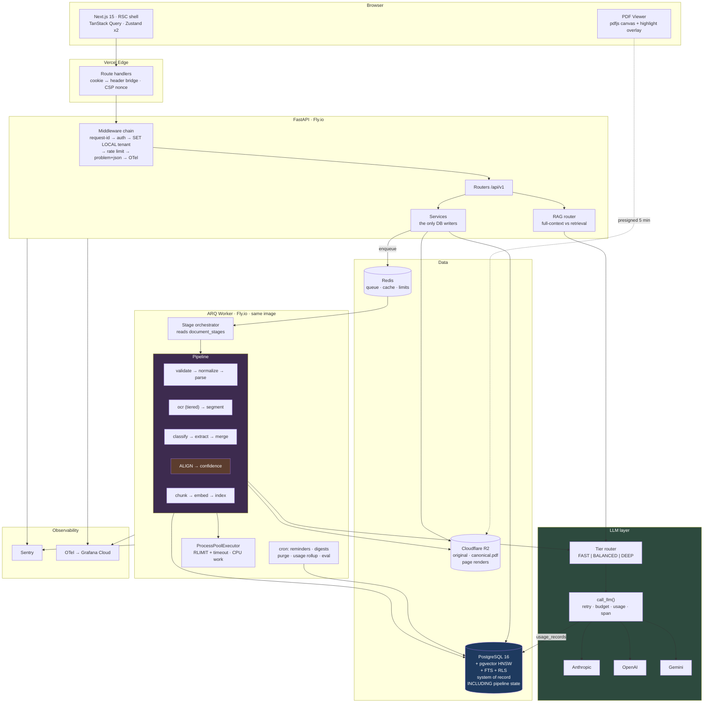
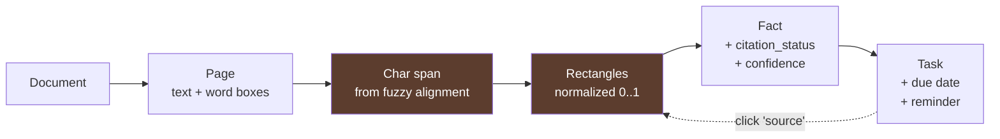

# DocFlow AI — Appendices A–J

> C (ER diagram) and D (endpoint map) live in [30-data-api.md](30-data-api.md).
> E (repo tree) lives in [60-delivery.md](60-delivery.md) §21.
> I (top 10 risks) lives in [60-delivery.md](60-delivery.md) §30.2.

---

## A. Final Recommended Tech Stack

### Frontend
| | Choice |
|---|---|
| Framework | Next.js 15 (App Router) |
| Language | TypeScript 5.6+, `strict`, `noUncheckedIndexedAccess` |
| Styling | Tailwind CSS v4 (CSS-first `@theme` tokens) |
| Components | shadcn/ui (Radix primitives, owned source) |
| Server state | TanStack Query v5 |
| Client state | Zustand — **two stores only** (`viewerStore`, `uploadStore`) |
| URL state | nuqs |
| Forms | react-hook-form + zod |
| PDF | `pdfjs-dist` (direct, dynamically imported) |
| Tables | TanStack Table |
| Dates | date-fns + @date-fns/tz |
| Charts | Recharts (usage page only) |
| Command palette | cmdk |
| Testing | Vitest, Testing Library, Playwright, MSW, axe-core |

### Backend
| | Choice |
|---|---|
| Language | Python 3.12 |
| Framework | FastAPI |
| Validation | Pydantic v2 |
| ORM | SQLAlchemy 2.0 (async, `Mapped[...]`) |
| Migrations | Alembic |
| Package manager | **uv** (fast, lockfile, workspaces — over poetry/pip-tools) |
| Jobs | **ARQ** + `ProcessPoolExecutor` for CPU-bound stages |
| Auth | Own: argon2id + JWT + rotating refresh w/ reuse detection; Authlib for OAuth |
| Lint/format/types | ruff, mypy `--strict` on `ai/` and `services/` |
| Testing | pytest, pytest-asyncio, testcontainers, VCR-style cassettes |

### Data
| | Choice |
|---|---|
| Primary DB | PostgreSQL 16 |
| Vector | **pgvector ≥ 0.8** (HNSW, `iterative_scan` enabled) |
| Lexical | Postgres FTS (`tsvector` + `ts_rank_cd`) + `pg_trgm` — *not* BM25; see §10.3 |
| Cache / queue / rate limit | Redis 7 (Upstash in prod) |
| Object storage | **Cloudflare R2** (MinIO locally) |

### AI
| | Choice |
|---|---|
| LLM abstraction | Own protocol, 3 thin native adapters. **No LangChain, no LiteLLM.** |
| FAST tier | `claude-haiku-4-5` — classification, merge, simple chat |
| BALANCED tier | `claude-sonnet-5` — extraction, reasoning chat |
| DEEP tier | `claude-opus-5` — low-confidence escalation, eval judge |
| Structured output | `strict: true` tool schemas / `output_config.format` + Pydantic |
| Embeddings | `text-embedding-3-small` (1536d) → benchmark `bge-m3` in Phase 3 |
| PDF parsing | PyMuPDF (word boxes) + pikepdf (repair) |
| DOCX→PDF | LibreOffice headless |
| OCR | Tesseract 5 (`eng+ben`) → cloud OCR / VLM fallback |
| Fuzzy alignment | rapidfuzz |
| Date parsing | dateparser + custom Bangla numeral/month normalizer |
| Reranker | *deferred* — Cohere Rerank or `bge-reranker-v2-m3` when eval justifies it |

### Infrastructure
| | Choice |
|---|---|
| Containers | Docker + Docker Compose (dev), one image for api+worker |
| Web hosting | Vercel |
| API/worker | Fly.io (Singapore) |
| Postgres | Neon (branch-per-PR) |
| Redis | Upstash |
| Storage | Cloudflare R2 |
| CI/CD | GitHub Actions |
| Errors | Sentry |
| Traces/metrics | OpenTelemetry (GenAI semconv) → Grafana Cloud (Phase 2) |
| Email | Resend |
| Secrets | Fly secrets + Vercel env; gitleaks in CI |

---

## B. Final Architecture Diagram

**The provenance chain, end to end:**

---

## F. MVP Milestone Checklist

**Phase 0 — Foundation**
- [ ] Monorepo + Compose (PG/pgvector, Redis, MinIO) + Makefile + `.env.example`
- [ ] FastAPI skeleton: settings, async DB, structlog, request-id, problem+json, `/health/ready`
- [ ] Alembic + `users`/`workspaces`/`memberships` + **RLS policies enabled and FORCEd**
- [ ] Tenant-isolation test suite (parameterized over all tables) — green
- [ ] Auth: register, verify email, login, refresh rotation + reuse detection, argon2id, Google OAuth
- [ ] Next.js shell: layout, Tailwind tokens, shadcn, TanStack Query, auth pages, dark mode
- [ ] CI: ruff, mypy, eslint, tsc, pytest, vitest, `alembic check`, gitleaks

**Phase 1 — Pipeline**
- [ ] **Week-1 spike: Tesseract `ben` on 20 real scanned circulars, accuracy measured by hand**
- [ ] Storage adapter + upload endpoint + magic-byte validation + SHA-256 dedup + quarantine→promote
- [ ] ARQ worker + `document_stages` machine + orchestrator + retry/backoff + per-stage idempotency
- [ ] Kill-the-worker resume test passes
- [ ] Normalization: DOCX/TXT/image → canonical PDF; 150 DPI page renders
- [ ] **Text map with rotation normalization** + 0/90/180/270 fixture test
- [ ] Tiered OCR: text-layer gate → Tesseract → quality gate → fallback stub
- [ ] LLM abstraction: protocol, Anthropic + OpenAI adapters, tier router, `call_llm` with `usage_records`

**Phase 1 — Intelligence**
- [ ] Classification prompt + schema; core extraction schema + `university_circular` extension
- [ ] Windowed extraction + merge stage
- [ ] **Span alignment → char offsets → word boxes → line-grouped rectangles**
- [ ] `citation_status` three-tier logic; ≥ 90% verified on clean fixtures
- [ ] Date normalization: Bangla numerals + months, DMY policy, relative, ambiguity flags
- [ ] Composite confidence + buckets (calibration once ≥ 200 labels exist)
- [ ] Chunking + embeddings + embedding cache + pgvector HNSW + `tsvector` + RRF fusion
- [ ] Injection detection → `security_flags`

**Phase 1 — Product**
- [ ] `document_facts` + `/analysis` + `/facts` + `/documents/{id}` with stages
- [ ] **Viewer: pdf.js, virtualization, highlight overlay, click-to-navigate, `?fact=` URL state**
- [ ] Chat: full-context router, SSE, typed citation events, refusal path
- [ ] Task generation (rules + LLM ordering) + task CRUD + `source_fact_id`
- [ ] Dashboard, library, tasks, calendar, upload, processing view — with designed empty/error states
- [ ] Demo workspace + `make seed` (zero LLM calls)
- [ ] Command palette, keyboard shortcuts, a11y pass

**Phase 1 — Proof**
- [ ] Eval harness + 40–60 labeled documents + metric implementations
- [ ] `docs/EVALUATION.md` generated with **real** numbers, N, and CIs
- [ ] Security suite: rate limits, headers, authz matrix, upload validation, injection
- [ ] Playwright: 10 flows, including the citation-click assertion
- [ ] Deployed: Fly + Vercel + Neon + Upstash + R2; anonymous demo works
- [ ] README with GIF, live link, and the measured-results table
- [ ] 8–12 ADRs written

---

## G. Production-Readiness Checklist

**Security**
- [ ] RLS enabled + FORCEd on every tenant table; isolation suite green
- [ ] Authz matrix tested for every (role × endpoint)
- [ ] All security headers set and asserted in tests; CSP with nonce
- [ ] Rate limits on every endpoint class, with `RateLimit-*` + `Retry-After`
- [ ] Upload validation: magic bytes, size, page count, subprocess `RLIMIT` + timeout
- [ ] ClamAV in the validate stage
- [ ] Injection defense layers implemented; `security_flags` surfaced in the UI
- [ ] Presigned URLs ≤ 5 min, `Content-Disposition: attachment`, never logged
- [ ] Secrets in a secret store; gitleaks clean; rotation documented
- [ ] Dependency scanning (pip-audit, npm audit, trivy) in CI
- [ ] `/security-review` + VibeSec audit run before the deploy

**Reliability**
- [ ] Health + readiness endpoints wired to platform checks
- [ ] Graceful shutdown: worker drains the in-flight stage on SIGTERM
- [ ] Retries with jitter; typed non-retryable errors fail fast
- [ ] Idempotency on POST + per-stage idempotency keys
- [ ] DB connection pool sized and monitored; PgBouncer in **transaction** mode (asserted at startup)
- [ ] Backups: Neon PITR + weekly `pg_dump` to R2
- [ ] **Restore drill rehearsed and documented with row counts**
- [ ] Storage lifecycle rules configured

**Observability**
- [ ] Structured JSON logs with request-id propagated **into worker jobs**
- [ ] Sentry on API, worker, and web, with release markers
- [ ] OTel traces including `llm.call` with GenAI semconv attributes
- [ ] The five dashboards built
- [ ] Alerts configured, each with a runbook in `docs/runbooks/`
- [ ] Cost dashboard + daily-spend alert + per-workspace budgets

**Performance**
- [ ] p95 API < 400 ms (excluding streaming)
- [ ] p95 pipeline < 90 s for a 10-page document
- [ ] Frontend budgets met (LCP, INP, route JS)
- [ ] No N+1s on list endpoints (verified with `EXPLAIN`)
- [ ] pgvector recall test in the eval suite
- [ ] k6 load test: 100 concurrent uploads drain cleanly

**Data & compliance**
- [ ] Migrations expand/contract; every `downgrade()` tested
- [ ] Soft delete + 30-day purge job running
- [ ] Account deletion honors immediate hard-delete
- [ ] Audit log covering view/download/delete/edit/invite/role-change/export/auth
- [ ] Privacy policy + terms; provider data-retention terms recorded in an ADR
- [ ] Data export endpoint (user's own data, JSON + originals)

**Quality**
- [ ] Coverage ≥ 80% overall; ≥ 95% on alignment, extraction, security, permissions
- [ ] Eval suite green with committed baselines; nightly regression alerting
- [ ] E2E suite in CI
- [ ] Manual QA on Safari and mobile Chrome (the viewer is the risk area)

---

## H. Hackathon-Ready Checklist

**Pre-built and verified working ≥ 1 week before**
- [ ] `git clone && make setup && make demo` → working seeded app in < 10 min on a clean machine
- [ ] `DEMO_MODE=1` serves pre-computed analyses with **zero** LLM calls
- [ ] Auth, workspaces, RLS
- [ ] Upload + validation + storage
- [ ] Pipeline + stage machine + retries
- [ ] Canonical PDF normalization + text map + rotation handling
- [ ] Tiered OCR
- [ ] LLM abstraction + tier routing + usage tracking
- [ ] **Span alignment + rectangles**
- [ ] Viewer + highlight overlay + virtualization + click-to-navigate
- [ ] RAG: chunk, embed, hybrid, fusion
- [ ] Task generation + calendar
- [ ] Design system + every shared component (`FactCard`, `ConfidenceBadge`, `CitationLink`, `StagePill`, `EmptyState`)
- [ ] Deploy pipeline: push to main → live in < 5 min
- [ ] **Two** document domains implemented, proving the registry seam is real

**The adaptation surface is exactly four files**
- [ ] `ai/extraction/schemas/<domain>.py`
- [ ] `ai/prompts/extraction/v1_<domain>.md`
- [ ] `ai/extraction/schemas/registry.py` (one line)
- [ ] `web/components/facts/panels/<Domain>Panel.tsx`
- [ ] **Verified: adding a domain requires no database migration**

**Demo assets ready**
- [ ] README template with 5 fill-in blanks
- [ ] Architecture diagram exported as an image
- [ ] `docs/EVALUATION.md` with real numbers already committed
- [ ] 3-minute demo script written and rehearsed twice
- [ ] Screen-recording setup tested (audio levels, resolution, cursor visibility)
- [ ] Backup: a recorded demo video, in case live fails

**On the day**
- [ ] 0:00–0:25 read, map facts to `kind`s, sketch the panel — **editor closed**
- [ ] 0:25–1:15 schema + prompt, iterate on 3 real samples
- [ ] 1:15–2:15 render panel, reuse only
- [ ] 2:15–2:50 process 5 docs, commit as seed fixtures
- [ ] 2:50–3:20 polish + deploy
- [ ] 3:20–3:50 **record the video**, update README
- [ ] 3:50–4:00 submit, stop coding

---

## J. Top 10 Things NOT to Build Initially

Ranked by how much time they would waste relative to their value.

| # | Don't build | Why not | Build it when |
|---|---|---|---|
| **1** | **A reranker, MMR, HyDE, query decomposition, or any advanced RAG technique** | Every one is a solution to a problem you have not measured. On single-document corpora they contribute approximately nothing. | Recall@10 measured below 0.85 on the eval set |
| **2** | **Billing, Stripe, subscription plans** | You have zero paying users. Quota enforcement against `usage_daily` is three lines and delivers the same cost protection. | You have 50+ people asking to pay |
| **3** | **A general policy engine (OPA/Casbin) or dynamic permissions** | Four roles and fifteen actions. A pure function with a table-driven test is smaller, faster, and more readable. | Customers require custom roles |
| **4** | **Microservices, an event bus, CQRS, or a service mesh** | Distributed systems tax with no distributed systems benefit at this scale. It will slow you down every single day. | Multiple teams need independent deploys |
| **5** | **A self-hosted Prometheus + Grafana + Loki + Tempo stack in production** | Sentry covers 90% of the need for free. Ship the LGTM stack as a Compose profile for the demo; do not operate it. | You have on-call rotation and custom SLOs |
| **6** | **WebSockets and realtime collaboration** | Polling with backoff is 15 lines. SSE is the correct next step, and it is one-directional. WS buys bidirectionality you do not need. | Collaborative editing or presence |
| **7** | **Presigned direct-to-storage upload** | Three endpoints and an abandoned-upload reconciliation flow to solve a problem you do not have at a 25 MB cap. | The limit exceeds ~50 MB, or upload timeouts appear in metrics |
| **8** | **Fine-tuning, self-hosted LLMs, or a custom embedding model** | You have no training data, no GPU budget, and no evidence that off-the-shelf models are the bottleneck. Prompt and schema improvements will beat fine-tuning for a long time. | You have 10k+ labeled examples and a measured plateau |
| **9** | **A mobile app** | A responsive PWA covers it. Two more platforms is 3× the surface area for a product with no users yet. | 10k+ MAU with >50% mobile |
| **10** | **Integrations (Drive, Slack, Notion, Gmail)** | Each is an OAuth flow, a sync engine, a token-refresh story, and a permanent support burden. | Requested by paying customers, not by imagined ones |

**Honorable mentions:** an admin panel (use `psql` + a Metabase container), a design-system package (until there is a second app), i18n infrastructure (until you have non-English *UI* users — note that Bangla *documents* are a different thing entirely), a plugin system, GraphQL, a custom auth provider integration layer, and soft delete on every table.

**The meta-rule:** every item above is something a competent engineer *could* build. The signal of a *senior* engineer is choosing not to, and being able to say exactly what evidence would change that decision. Put that reasoning in the README — it is worth more than the features would have been.
